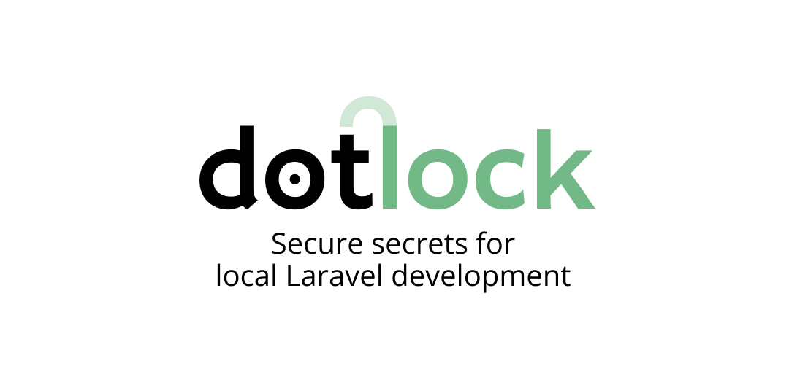

<p align="center">
    
</p>

## The problem

Some projects need secrets to work locally: an OpenAI key, a Stripe test key, a sandbox API token password…

They sit in `.env` or `~/.bashrc` in plain text. Every process on your machine can read them: a malicious dependency, a rogue agent, a compromised application.

## The solution

Dotlock moves them to `.env.secrets`, a gitignored file that looks like `.env` but the values are encrypted with a passphrase you choose:

```dotenv
# .env.secrets
OPENAI_API_KEY="mvGOEc0Vf1Xh0…"
STRIPE_SECRET="Tir/AHfuTgKoS…"
```

Now run `php artisan dev`:

```sh
php artisan dev

   2 encrypted secrets to unlock.  

 ┌ Passphrase ──────────────────────────────────────────────────┐
 │                                                              │
 └──────────────────────────────────────────────────────────────┘
```

Dotlock prompts for your passphrase, decrypts the values, and the usual Laravel dev processes start with the secrets in their environment variables. Secrets are never written to disk.

**Laravel then runs as usual**. Nothing else in the application changes.

## Install

```sh
composer require --dev mnapoli/dotlock
```

Add this at the top of `bootstrap/app.php`, before `Application::configure()`:

```php
// Load encrypted secrets into the environment, before config is built.
// Does nothing unless APP_SECRETS_KEY is set and `.env.secrets` exists.
if (class_exists(\Dotlock\Secrets::class)) {
    \Dotlock\Secrets::unlock(dirname(__DIR__));
}
```

Then add the file to `.gitignore`:

```
.env.secrets
```

You _could_ commit it to share the secrets with teammates, but you'd have to share the passphrase and everyone would share the same secrets.

## Usage

Import a secret from `.env` or add a new one:

```sh
php artisan secrets:set

 ┌ Which environment variable? ─────────────────────────────────┐
 │ API_TOKEN                                                  ⌄ │
 └──────────────────────────────────────────────────────────────┘
  Names in .env and names already encrypted are both offered. A new one is fine too.
  
 ┌ Value for API_TOKEN ─────────────────────────────────────────┐
 │ ••••••••••••••••••                                           │
 └──────────────────────────────────────────────────────────────┘

 ┌ Passphrase ──────────────────────────────────────────────────┐
 │ •••••••••                                                    │
 └──────────────────────────────────────────────────────────────┘
```

If the secret was already in `.env`, it is moved to `.env.secrets`. The passphrase is your password that unlocks everything, it is never stored anywhere, remember it!

Leave non-secret environment variables in `.env`, `.env.secrets` is only for secrets.

Start working:

```sh
php artisan dev
```

Other commands:

| Command               |                                                        |
|-----------------------|--------------------------------------------------------|
| `secrets:list`        | List the secret names, not the values                  |
| `secrets:get NAME`    | Retrieve a secret value                                |
| `secrets:forget NAME` | Forget a secret                                        |
| `secrets:rekey`       | Change the passphrase without rewriting a single value |

For non-interactive use (scripts, a shell you trust…), export the passphrase in `APP_SECRETS_KEY` (every artisan command and request unlock the secrets automatically):

```sh
export APP_SECRETS_KEY="your passphrase"
```

You can also read it from your password manager rather than typing it into shell history, e.g. with 1Password:

```sh
export APP_SECRETS_KEY="$(op read op://Private/my-app/passphrase)"
```

## Limits

- **`config:cache` and `optimize` are forbidden while a `.env.secrets` exists.** Caching config resolves every `env()` call and writes the answers to `bootstrap/cache/config.php` in plain text. That would put your secrets on disk in plaintext, so Dotlock blocks it.
- **Tests don't unlock secrets.** When `APP_ENV` is `testing`, `.env.secrets` are never read even with the passphrase in the environment.
- **Commands without the passphrase don't have the secrets.** E.g. if Claude Code runs an artisan command, the `.env.secrets` environment variables will be empty. The command will work as long as it doesn't need the secrets (e.g. `php artisan migrate`, etc.) so most of the time there is no problem.

## How it works

- The passphrase is stretched with **Argon2id** into a key that opens one thing: a random **master key** kept encrypted in the file's header. The master key encrypts the values with **XSalsa20-Poly1305** (libsodium's `secretbox`). Changing the passphrase rewrites one line, not every value.
- Encryption is authenticated, so a wrong passphrase and a corrupted file are detected outright, the vault can never hand back plausible-looking garbage.
- Values are base64 on one line whatever they contain, so the vault can hold variables with any value (unlike `.env`): a multi-line PEM key, a value with quotes or `#` in it.
- The file is `chmod 0600`, and the passphrase is never stored anywhere. There is no recovery if the passphrase is lost.

## Alternatives

**`php artisan env:encrypt`**

It encrypts the whole `.env` into `.env.encrypted` meant to be committed and decrypted on deploy. It solves prod secrets, not your local machine: to use it you run `env:decrypt`, and the plaintext `.env` is back on disk. Dotlock encrypts value by value, keeps the names readable, and the decrypted values only ever exist in process memory.

**1Password CLI**

`op run --env-file` injects secrets referenced as `op://vault/item/field` into one command. The limit is coverage: only the processes you remember to wrap get the secrets — `artisan tinker`, a test run started from your IDE, or any artisan command run directly sees nothing. Each invocation also pays the CLI's latency, and often a biometric prompt. Dotlock loads at bootstrap inside PHP, so every entry point gets the same environment, offline and instantly. The two compose well, though: a 1Password vault is the right home for the *passphrase* — `export APP_SECRETS_KEY="$(op read op://Private/my-app/passphrase)"`.

**Apple Keychain**

Solid storage, but macOS-only, and nothing connects it to `env()` — you end up writing the wrapper scripts yourself, with the same coverage problem as above. Like 1Password, it is a good place to keep the passphrase rather than the secrets.

## Requirements

- PHP 8.4+ with the sodium extension (bundled by default)
- Laravel 13

## License

MIT
